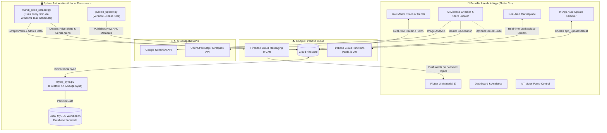

# 🌱 FarmTech — Smart Agriculture & Mandi Intelligence Platform

[](https://flutter.dev)
[](https://dart.dev)
[](https://firebase.google.com)
[](https://www.mysql.com)
[](https://ai.google.dev)
[](https://android.com)

**FarmTech** is an all-in-one Smart Agriculture and Market Intelligence ecosystem engineered specifically for farmers. It unifies live agricultural market prices across Andhra Pradesh and Telangana, smart crop-price push alerts, AI-driven plant disease diagnostics with CIBRC/ICAR-approved treatments, a farmer-to-farmer direct marketplace, smart IoT irrigation motor controls, and automated local data persistence.

---

## 📑 Table of Contents
- [Core Features](#-core-features)
  - [1. Live Mandi Commodity Price Tracker](#1-live-mandi-commodity-price-tracker)
  - [2. Targeted Crop Price Change Alerts](#2-targeted-crop-price-change-alerts)
  - [3. AI Plant Disease Diagnosis & Store Directory](#3-ai-plant-disease-diagnosis--store-directory)
  - [4. Real-Time Farmer-to-Farmer Marketplace](#4-real-time-farmer-to-farmer-marketplace)
  - [5. Smart IoT Irrigation Controller](#5-smart-iot-irrigation-controller)
  - [6. In-App Auto-Update Distribution System](#6-in-app-auto-update-distribution-system)
  - [7. Local MySQL Workbench Data Persistence](#7-local-mysql-workbench-data-persistence)
- [System Architecture](#-system-architecture)
- [Technology Stack](#-technology-stack)
- [Project Directory Structure](#-project-directory-structure)
- [Getting Started & Installation](#-getting-started--installation)
  - [1. Mobile Application (Flutter)](#1-mobile-application-flutter)
  - [2. Mandi Scraper & Task Scheduler](#2-mandi-scraper--task-scheduler)
  - [3. MySQL Database Setup & Sync](#3-mysql-database-setup--sync)
  - [4. Gemini AI Configuration](#4-gemini-ai-configuration)
  - [5. In-App Update Publisher](#5-in-app-update-publisher)
- [Testing & Quality Assurance](#-testing--quality-assurance)
- [Security & Data Protection](#-security--data-protection)

---

## 🚀 Core Features

### 1. Live Mandi Commodity Price Tracker
- **Real-Time APMC Data**: Scrapes and indexes daily mandi auction records across Andhra Pradesh and Telangana agricultural markets.
- **3-Tier Price Breakdown**:
  - **Minimum Price (₹/Quintal)**: The lowest recorded auction rate.
  - **Modal Price (Mid) (₹/Quintal)**: The weighted average trading rate.
  - **Maximum Price (₹/Quintal)**: The peak premium auction rate.
- **Price Trend Visualizer**: Interactive scrub-enabled timeline charts tracking historical fluctuations per crop.
- **Smart Filtering**: Instant search by commodity name (Groundnut, Cotton, Chilli, Tomato, Onion, etc.), district, or market yard.

### 2. Targeted Crop Price Change Alerts
- **Star to Follow (⭐)**: Farmers select only the crops they grow or trade.
- **FCM Topic Architecture**: Tapping ⭐ automatically subscribes the device to `crop_<commodity>` FCM topics (e.g. `crop_groundnut`, `crop_cotton`).
- **Strict Change-Only Guard**:
  - If a price scrape runs and the modal price remains the same (`old_price == new_price`), **zero spam notifications** are generated.
  - If the price increases or decreases (`old_price != new_price`), an instant push notification is broadcast with exact shift metrics:
    > **⭐ Groundnut Price Increased (+₹150)**  
    > *₹8,100 → ₹8,250/qtl at Kurnool Mandi (Kurnool)*
- **Non-Followed Crop Filter**: Non-followed crops never generate alerts for that user.

### 3. AI Plant Disease Diagnosis & Store Directory
- **Instant Photo Diagnosis**: Capture leaf symptoms using the camera or select an existing photo from the gallery.
- **Dual-Engine Intelligence**:
  - **Cloud Google Gemini AI**: Cloud-hosted vision analysis with zero farmer-side API key friction.
  - **Built-in Agricultural Knowledge Engine**: Offline/fallback expert rule base covering fungal, bacterial, viral, and pest damages across major Indian crops.
- **CIBRC & ICAR Certified Cures**:
  - Chemical & Organic Active Ingredients (e.g., Mancozeb 75% WP, Chlorpyrifos 20% EC, Imidacloprid).
  - Exact dosage per litre of water and acre.
  - Mandatory Post-Harvest Intervals (PHI) and safety waiting periods.
  - Certified Brand Recommendations with manufacturer details (e.g., *Dithane M-45 by Indofil*, *Confidor by Bayer*).
- **Nearby Agro-Dealer Directory**:
  - Geodesic Haversine distance calculator.
  - Discovers local fertilizer and pesticide dealers via free OpenStreetMap (Overpass API) without requiring paid Google Maps API billing.

### 4. Real-Time Farmer-to-Farmer Marketplace
- **Live Streamed Listings**: Powered by Cloud Firestore real-time streams (`collection('marketplace').snapshots()`).
- **Instant Posting**: Farmers post surplus harvests, organic seeds, fertilizers, or farm machinery rentals with photo upload, quantity, price, and direct phone contact.
- **Dual-Tier Storage**: Real-time cloud access with automated local backup to MySQL `farmtech.marketplace_listings`.

### 5. Smart IoT Irrigation Controller
- **Remote Motor Pump Operations**: Start and stop farm borewell and irrigation motors directly from the app.
- **Telemetry Indicators**: Real-time status indicators (Motor ON/OFF, Power Health, Auto-Off Timers, and Water Level monitors).

### 6. In-App Auto-Update Distribution System
- **Frictionless App Updates**: Farmers receive in-app update popups whenever a new build is deployed.
- **Zero Play Store Dependency**: Background check queries Firestore `app_updates/latest` on launch.
- **1-Command Deployment**: The developer publishes a new APK URL and release notes via `scripts/publish_update.py`.

### 7. Local MySQL Workbench Data Persistence
- **Local Data Mirror**: Bidirectional sync between Cloud Firestore and local MySQL Workbench.
- **Database Schema**: Dedicated `farmtech` database housing tables for `mandi_prices` and `marketplace_listings`.
- **Permanent Archival**: Complete historical storage for offline analytics and reporting.

---

## 🏛 System Architecture



---

## 🛠 Technology Stack

| Domain | Technology / Library | Purpose |
| :--- | :--- | :--- |
| **Mobile Framework** | Flutter 3.x / Dart 3.10 | Cross-platform high-performance Android UI |
| **State & Local Storage** | `shared_preferences`, `Provider` pattern | User preferences, followed crop states, cached prices |
| **Cloud Database** | Cloud Firestore | Real-time commodity data, listings, update metadata |
| **Push Notifications** | `firebase_messaging`, `flutter_local_notifications` | Topic-based price shift alerts & local popups |
| **AI Diagnosis** | Google Gemini Vision API / Expert Rule Engine | Leaf image pathology & disease treatment advice |
| **Geospatial & GPS** | `geolocator`, OpenStreetMap Overpass API | Local dealer discovery and Haversine distance calc |
| **Image Handling** | `image_picker`, Base64 encoding | Leaf photos & marketplace crop image uploads |
| **Web Scraping** | Python 3.14, `requests`, `beautifulsoup4`, `lxml` | Automated APMC Mandi web scraping |
| **Local Database** | MySQL 8.0, `mysql-connector-python` | Local persistent data warehouse in MySQL Workbench |
| **Automation** | Windows Task Scheduler (`powershell`) | Automated 30-minute background scraping task |

---

## 📂 Project Directory Structure

```text
FarmTech/
├── android/                        # Native Android Gradle configuration & manifests
│   ├── app/
│   │   ├── build.gradle.kts       # Release signing, desugaring, ProGuard rules
│   │   ├── google-services.json   # Firebase Android client configuration
│   │   └── src/main/AndroidManifest.xml # Permissions (Camera, Location, Internet, Notifications)
├── assets/                         # Application branding & icons
│   └── logo.png
├── functions/                      # Firebase Cloud Functions (Node.js 20)
│   ├── index.js                    # analyzePlantDisease, nearbyAgroStores, syncMandiPrices
│   └── package.json
├── lib/                            # Flutter Dart application code
│   ├── models/
│   │   ├── agricultural_product.dart # Verified product specification
│   │   ├── brand_info.dart           # CIBRC / ICAR certified brand model
│   │   ├── dealer_model.dart         # Agro store & Haversine distance model
│   │   └── disease_model.dart        # Plant disease & chemical treatment model
│   ├── services/
│   │   ├── dealer_service.dart       # Overpass API store locator service
│   │   ├── disease_service.dart      # Disease repository & treatment enricher
│   │   └── location_service.dart     # GPS permission and coordinates service
│   ├── widgets/
│   │   ├── brand_recommendation_card.dart # Certified brand UI card
│   │   ├── dealer_directory_sheet.dart    # Nearby dealer modal view
│   │   └── disease_treatment_view.dart    # Structured treatment UI
│   ├── disease_checker.dart        # Plant disease scanner & AI analyzer page
│   ├── firebase_options.dart       # FlutterFire generated config
│   ├── splash_screen.dart          # Animated startup splash screen
│   └── main.dart                   # Core app entry, Dashboard, Mandi, Marketplace, IoT
├── scripts/                        # Automation & backend scripts
│   ├── disease_proxy_server.py     # Local proxy server for testing
│   ├── mandi_price_scraper.py      # Automated APMC web scraper & FCM price alert broadcaster
│   ├── mysql_sync.py               # Firestore to MySQL Workbench sync worker
│   ├── publish_update.py           # CLI tool to publish in-app version updates
│   ├── register_mandi_scraper_task.ps1 # 30-min repeating Windows Task Scheduler installer
│   └── set_gemini_key.py           # 1-command tool to set Gemini API key in Firestore
├── test/                           # Automated test suites
│   ├── disease_checker_test.dart   # Unit tests for models, Haversine, brand rendering
│   └── widget_test.dart            # Flutter widget & scrub chart tests
├── pubspec.yaml                    # Flutter project dependencies
├── requirements.txt                # Python backend dependencies
├── firestore.rules                 # Cloud Firestore security rules
└── README.md                       # Comprehensive project documentation
```

---

## ⚡ Getting Started & Installation

### 1. Mobile Application (Flutter)

#### Prerequisites:
- Flutter SDK (>= 3.24.0)
- Android SDK (API 34+)
- Java JDK 17

#### Setup & Build:
```powershell
# 1. Fetch Flutter dependencies
flutter pub get

# 2. Run test suites to ensure 100% integrity
flutter test

# 3. Build optimized lightweight APK (Recommended for Android phones: ~25 MB)
flutter build apk --release --split-per-abi

# Output files located at:
# - build\app\outputs\flutter-apk\app-arm64-v8a-release.apk (64-bit phones, ~25.4 MB)
# - build\app\outputs\flutter-apk\app-armeabi-v7a-release.apk (32-bit phones, ~23.2 MB)

# Or build universal single APK:
flutter build apk --release
# Output: build\app\outputs\flutter-apk\app-release.apk (~56.9 MB)
```

---

### 2. Mandi Scraper & Task Scheduler

#### Setup Python Environment:
```powershell
# 1. Install required Python packages
pip install -r requirements.txt

# 2. Ensure your Firebase service account key is placed at:
# scripts/serviceAccountKey.json

# 3. Run a manual test scrape
python scripts/mandi_price_scraper.py
```

#### Automate with Windows Task Scheduler (Runs Every 30 Minutes):
Run PowerShell as Administrator:
```powershell
powershell -ExecutionPolicy Bypass -File scripts\register_mandi_scraper_task.ps1
```
*This schedules a background task named `FarmTech Mandi Scraper` that automatically scrapes live prices and broadcasts FCM price-change push alerts.*

---

### 3. MySQL Database Setup & Sync

Ensure MySQL Workbench / Server is running locally.

#### Database Creation:
```sql
CREATE DATABASE IF NOT EXISTS farmtech;
USE farmtech;

-- Mandi prices table
CREATE TABLE IF NOT EXISTS mandi_prices (
    id INT AUTO_INCREMENT PRIMARY KEY,
    state VARCHAR(50),
    district VARCHAR(100),
    market VARCHAR(100),
    commodity VARCHAR(100),
    min_price INT,
    modal_price INT,
    max_price INT,
    arrival_date VARCHAR(50),
    updated_at TIMESTAMP DEFAULT CURRENT_TIMESTAMP ON UPDATE CURRENT_TIMESTAMP,
    UNIQUE KEY uq_record (state, district, market, commodity)
);

-- Farmer marketplace table
CREATE TABLE IF NOT EXISTS marketplace_listings (
    id VARCHAR(100) PRIMARY KEY,
    title VARCHAR(255),
    crop VARCHAR(100),
    quantity VARCHAR(50),
    price VARCHAR(50),
    seller_name VARCHAR(100),
    phone VARCHAR(20),
    location VARCHAR(100),
    created_at TIMESTAMP DEFAULT CURRENT_TIMESTAMP
);
```

#### Run the Bidirectional Sync:
```powershell
python scripts/mysql_sync.py
```

---

### 4. Gemini AI Configuration

To configure the centralized Gemini API key in Cloud Firestore so all mobile users can diagnose crop diseases without manual key entry:
```powershell
python scripts/set_gemini_key.py --key "YOUR_GOOGLE_AI_STUDIO_GEMINI_KEY"
```

---

### 5. In-App Update Publisher

When you compile a new APK build and want all users to see an in-app update dialog:
```powershell
python scripts/publish_update.py --version 1.1.0 --build 2 --url "https://your-server.com/app-arm64-v8a-release.apk" --notes "Live mandi charts and price alerts updated!"
```

---

## 🧪 Testing & Quality Assurance

The codebase includes comprehensive unit and widget tests:

```powershell
# Run the complete test suite
flutter test
```

### Covered Test Specs:
- **BrandInfo Serialization**: Verified dictionary mapping and deserialization.
- **DiseaseModel Validation**: Ensures CIBRC and ICAR waiting periods and active ingredients are correctly structured.
- **Geodesic Haversine Calculation**: Validates distance accuracy between GPS points for agro-dealer discovery.
- **UI Widget Integrity**: Validates `BrandRecommendationCard`, `CropPriceTrendChart`, and `DashboardPage` layout rendering.
- **Static Code Analysis**: `dart analyze .` passes with **0 issues**.

---

## 🔒 Security & Data Protection

- **Credentials Safety**: `scripts/serviceAccountKey.json`, `.env`, and keystores are strictly guarded in `.gitignore`.
- **Firestore Security Rules**: Configured in `firestore.rules` to enforce read/write permissions on `mandi_prices`, `marketplace`, `agro_stores`, and `app_config`.
- **Safe Fallbacks**: Zero-crash design ensures that if a network connection is lost or an API is unkeyed, the app gracefully degrades to the local expert agricultural engine.

---

## 👨‍💻 Author & Contributions
- **Developer**: Anandh ([@sirrianand-pixel](https://github.com/sirrianand-pixel))
- **Repository**: [https://github.com/sirrianand-pixel/farmtech](https://github.com/sirrianand-pixel/farmtech)

*Contributions, issues, and feature suggestions are welcome via GitHub pull requests and issues!*
